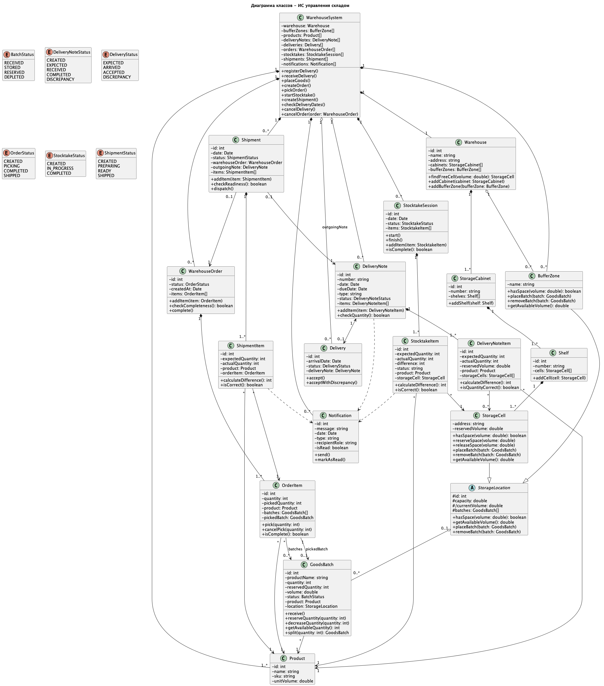

```
@startuml
title Диаграмма классов - ИС управления складом

skinparam classAttributeIconSize 0
hide empty members


' ===== Контроллер =====


class WarehouseSystem {
    - warehouse: Warehouse
    - bufferZones: BufferZone[]
    - products: Product[]
    - deliveryNotes: DeliveryNote[]
    - deliveries: Delivery[]
    - orders: WarehouseOrder[]
    - stocktakes: StocktakeSession[]
    - shipments: Shipment[]
    - notifications: Notification[]

    + registerDelivery()
    + receiveDelivery()
    + placeGoods()
    + createOrder()
    + pickOrder()
    + startStocktake()
    + createShipment()
    + checkDeliveryDates()
    + cancelDelivery()
    + cancelOrder(order: WarehouseOrder)
}


' ===== Физическая структура склада =====


class Warehouse {
    - id: int
    - name: string
    - address: string
    - cabinets: StorageCabinet[]
    - bufferZones: BufferZone[]

    + findFreeCell(volume: double): StorageCell
    + addCabinet(cabinet: StorageCabinet)
    + addBufferZone(bufferZone: BufferZone)
}

class StorageCabinet {
    - id: int
    - number: string
    - shelves: Shelf[]

    + addShelf(shelf: Shelf)
}

class Shelf {
    - id: int
    - number: string
    - cells: StorageCell[]

    + addCell(cell: StorageCell)
}

abstract class StorageLocation {
    # id: int
    # capacity: double
    # /currentVolume: double
    # batches: GoodsBatch[]

    + hasSpace(volume: double): boolean
    + getAvailableVolume(): double
    + placeBatch(batch: GoodsBatch)
    + removeBatch(batch: GoodsBatch)
}

class StorageCell {
    - address: string
    - reservedVolume: double

    + hasSpace(volume: double): boolean
    + reserveSpace(volume: double)
    + releaseSpace(volume: double)
    + placeBatch(batch: GoodsBatch)
    + removeBatch(batch: GoodsBatch)
    + getAvailableVolume(): double
}

class BufferZone {
    - name: string

    + hasSpace(volume: double): boolean
    + placeBatch(batch: GoodsBatch)
    + removeBatch(batch: GoodsBatch)
    + getAvailableVolume(): double
}


' ===== Товары =====


class Product {
    - id: int
    - name: string
    - sku: string
    - unitVolume: double
}

class GoodsBatch {
    - id: int
    - productName: string
    - quantity: int
    - reservedQuantity: int
    - volume: double
    - status: BatchStatus
    - product: Product
    - location: StorageLocation

    + receive()
    + reserveQuantity(quantity: int)
    + decreaseQuantity(quantity: int)
    + getAvailableQuantity(): int
    + split(quantity: int): GoodsBatch
}


' ===== Приемка =====


class DeliveryNote {
    - id: int
    - number: string
    - date: Date
    - dueDate: Date
    - type: string
    - status: DeliveryNoteStatus
    - items: DeliveryNoteItem[]

    + addItem(item: DeliveryNoteItem)
    + checkQuantity(): boolean
}

class DeliveryNoteItem {
    - id: int
    - expectedQuantity: int
    - actualQuantity: int
    - reservedVolume: double
    - product: Product
    - storageCells: StorageCell[]

    + calculateDifference(): int
    + isQuantityCorrect(): boolean
}

class Delivery {
    - id: int
    - arrivalDate: Date
    - status: DeliveryStatus
    - deliveryNote: DeliveryNote

    + accept()
    + acceptWithDiscrepancy()
}


' ===== Заказы =====


class WarehouseOrder {
    - id: int
    - status: OrderStatus
    - createdAt: Date
    - items: OrderItem[]

    + addItem(item: OrderItem)
    + checkCompleteness(): boolean
    + complete()
}

class OrderItem {
    - id: int
    - quantity: int
    - pickedQuantity: int
    - product: Product
    - batches: GoodsBatch[]
    - pickedBatch: GoodsBatch

    + pick(quantity: int)
    + cancelPick(quantity: int)
    + isComplete(): boolean
}


' ===== Инвентаризация =====


class StocktakeSession {
    - id: int
    - date: Date
    - status: StocktakeStatus
    - items: StocktakeItem[]

    + start()
    + finish()
    + addItem(item: StocktakeItem)
    + isComplete(): boolean
}

class StocktakeItem {
    - id: int
    - expectedQuantity: int
    - actualQuantity: int
    - difference: int
    - status: string
    - product: Product
    - storageCell: StorageCell

    + calculateDifference(): int
    + isCorrect(): boolean
}


' ===== Отгрузка =====


class Shipment {
    - id: int
    - date: Date
    - status: ShipmentStatus
    - warehouseOrder: WarehouseOrder
    - outgoingNote: DeliveryNote
    - items: ShipmentItem[]

    + addItem(item: ShipmentItem)
    + checkReadiness(): boolean
    + dispatch()
}

class ShipmentItem {
    - id: int
    - expectedQuantity: int
    - actualQuantity: int
    - product: Product
    - orderItem: OrderItem

    + calculateDifference(): int
    + isCorrect(): boolean
}


' ===== Уведомления =====


class Notification {
    - id: int
    - message: string
    - date: Date
    - type: string
    - recipientRole: string
    - isRead: boolean

    + send()
    + markAsRead()
}


' ===== Перечисления =====


enum BatchStatus {
    RECEIVED
    STORED
    RESERVED
    DEPLETED
}

enum DeliveryNoteStatus {
    CREATED
    EXPECTED
    RECEIVED
    COMPLETED
    DISCREPANCY
}

enum DeliveryStatus {
    EXPECTED
    ARRIVED
    ACCEPTED
    DISCREPANCY
}

enum OrderStatus {
    CREATED
    PICKING
    COMPLETED
    SHIPPED
}

enum StocktakeStatus {
    CREATED
    IN_PROGRESS
    COMPLETED
}

enum ShipmentStatus {
    CREATED
    PREPARING
    READY
    SHIPPED
}


' ===== Связи физической структуры =====


Warehouse "1" *-- "1..*" StorageCabinet
StorageCabinet "1" *-- "1..*" Shelf
Shelf "1" *-- "1..*" StorageCell

StorageCell --|> StorageLocation
BufferZone --|> StorageLocation

Warehouse "1" o-- "0..*" BufferZone

StorageLocation "0..1" o-- "0..*" GoodsBatch


' ===== Товары =====


GoodsBatch "*" --> "1" Product


' ===== Приемка =====


DeliveryNote "1" *-- "1..*" DeliveryNoteItem
DeliveryNoteItem "*" --> "1" Product
DeliveryNoteItem "*" --> "0..*" StorageCell

DeliveryNote "1" <--> "0..1" Delivery

' ===== Заказы =====


WarehouseOrder "1" *-- "1..*" OrderItem
OrderItem "*" --> "1" Product
OrderItem "*" --> "0..*" GoodsBatch : batches
OrderItem "1" --> "0..1" GoodsBatch : pickedBatch


' ===== Инвентаризация =====


StocktakeSession "1" *-- "1..*" StocktakeItem
StocktakeItem "*" --> "1" Product
StocktakeItem "*" --> "1" StorageCell


' ===== Отгрузка =====


Shipment "0..1" --> "1" WarehouseOrder
Shipment "0..1" --> "1" DeliveryNote : outgoingNote
Shipment "1" *-- "1..*" ShipmentItem
ShipmentItem "*" --> "1" Product
ShipmentItem "*" --> "1" OrderItem


' ===== Контроллер =====


WarehouseSystem "1" *-- "1" Warehouse
WarehouseSystem "1" *-- "0..*" BufferZone
WarehouseSystem "1" *-- "1..*" Product
WarehouseSystem "1" o-- "0..*" DeliveryNote
WarehouseSystem "1" o-- "0..*" Delivery
WarehouseSystem "1" *-- "0..*" WarehouseOrder
WarehouseSystem "1" *-- "0..*" StocktakeSession
WarehouseSystem "1" *-- "0..*" Shipment
WarehouseSystem "1" *-- "0..*" Notification


' ===== Уведомления =====


DeliveryNote ..> Notification
StocktakeItem ..> Notification
ShipmentItem ..> Notification

@enduml
```
