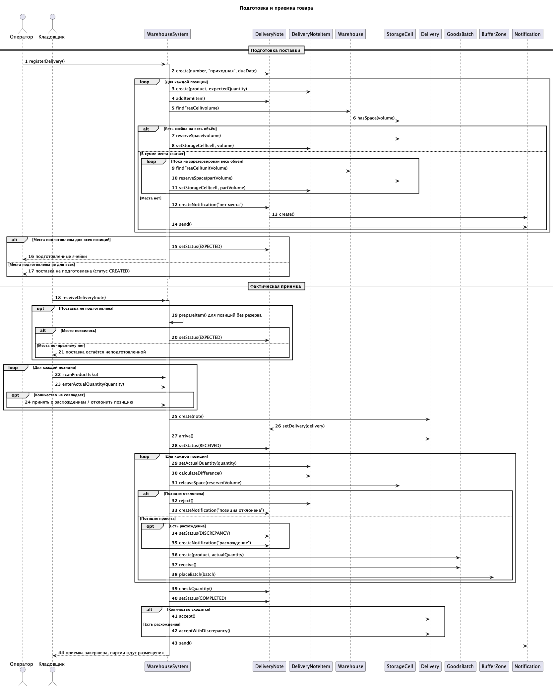
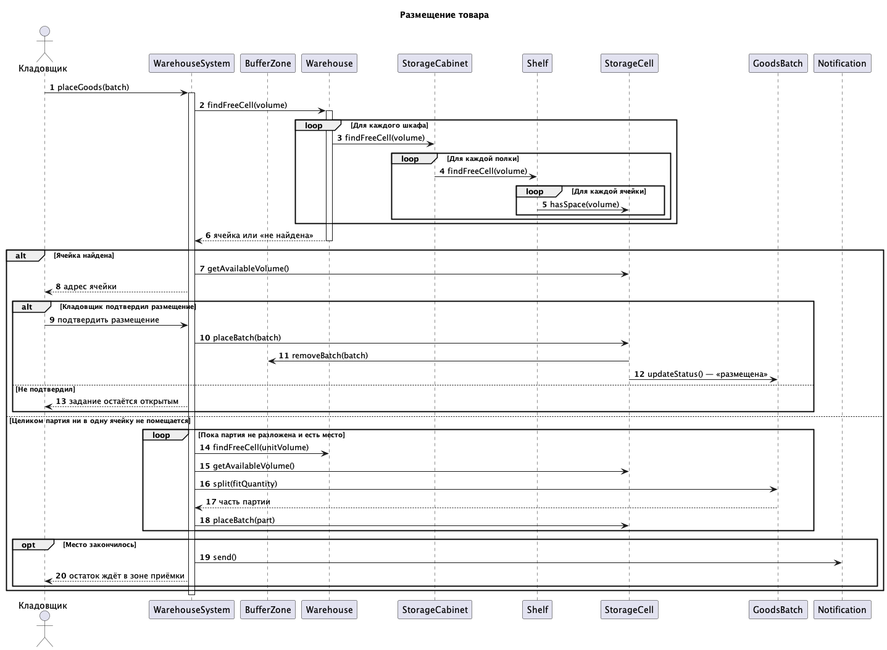
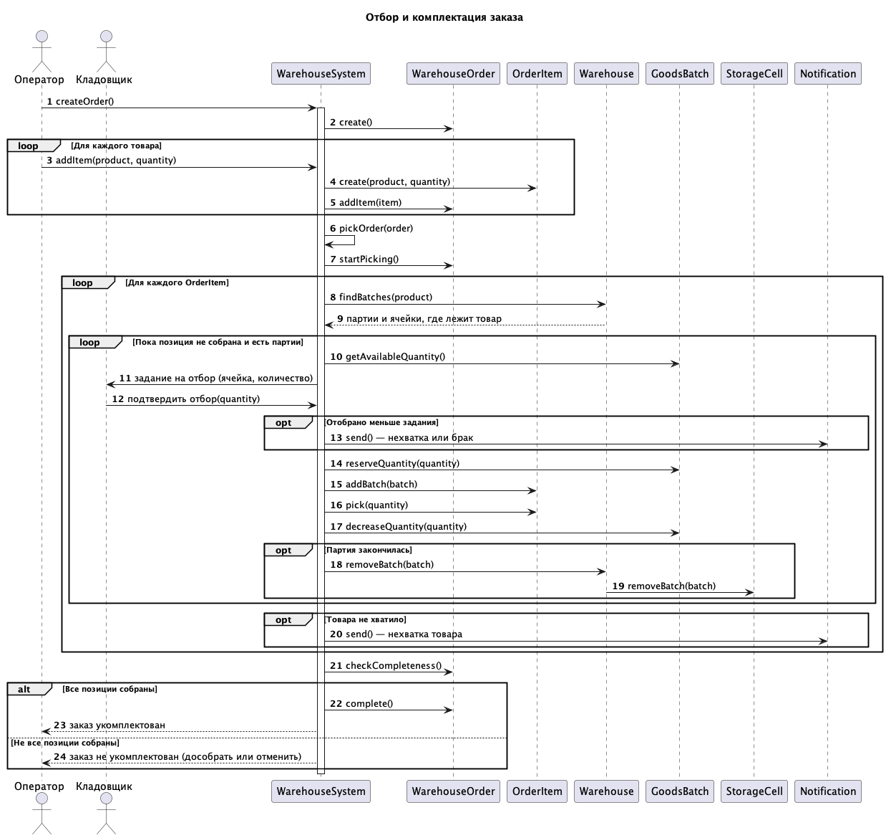
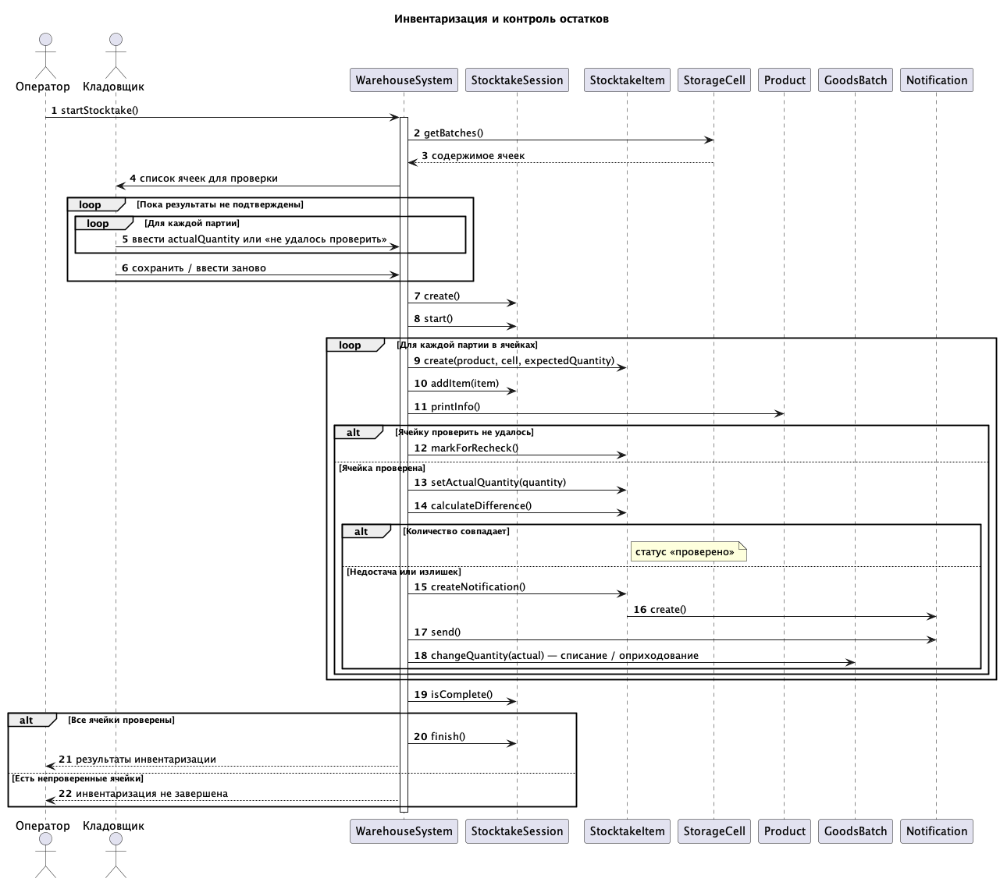
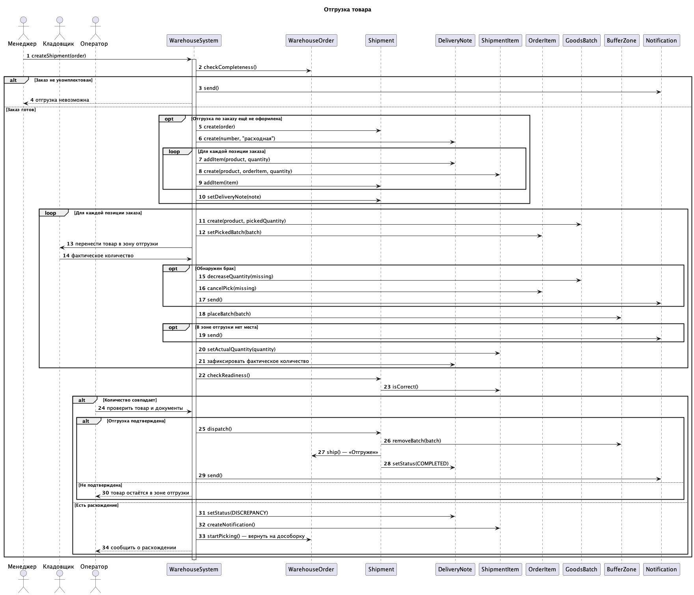

```
@startuml
title Подготовка и приемка товара

autonumber

actor "Оператор" as Operator
actor "Кладовщик" as Worker

participant "WarehouseSystem" as System
participant "DeliveryNote" as Note
participant "DeliveryNoteItem" as Item
participant "Warehouse" as Warehouse
participant "StorageCell" as Cell
participant "Delivery" as Delivery
participant "GoodsBatch" as Batch
participant "BufferZone" as Zone
participant "Notification" as Notif

== Подготовка поставки ==

Operator -> System: registerDelivery()
activate System
System -> Note: create(number, "приходная", dueDate)

loop Для каждой позиции
    System -> Item: create(product, expectedQuantity)
    System -> Note: addItem(item)
    System -> Warehouse: findFreeCell(volume)
    Warehouse -> Cell: hasSpace(volume)

    alt Есть ячейка на весь объём
        System -> Cell: reserveSpace(volume)
        System -> Item: setStorageCell(cell, volume)
    else В сумме места хватает
        loop Пока не зарезервирован весь объём
            System -> Warehouse: findFreeCell(unitVolume)
            System -> Cell: reserveSpace(partVolume)
            System -> Item: setStorageCell(cell, partVolume)
        end
    else Места нет
        System -> Note: createNotification("нет места")
        Note -> Notif: create()
        System -> Notif: send()
    end
end

alt Места подготовлены для всех позиций
    System -> Note: setStatus(EXPECTED)
    System --> Operator: подготовленные ячейки
else Места подготовлены не для всех
    System --> Operator: поставка не подготовлена (статус CREATED)
end
deactivate System

== Фактическая приемка ==

Worker -> System: receiveDelivery(note)
activate System

opt Поставка не подготовлена
    System -> System: prepareItem() для позиций без резерва
    alt Место появилось
        System -> Note: setStatus(EXPECTED)
    else Места по-прежнему нет
        System --> Worker: поставка остаётся неподготовленной
    end
end

loop Для каждой позиции
    Worker -> System: scanProduct(sku)
    Worker -> System: enterActualQuantity(quantity)
    opt Количество не совпадает
        Operator -> System: принять с расхождением / отклонить позицию
    end
end

System -> Delivery: create(note)
Delivery -> Note: setDelivery(delivery)
System -> Delivery: arrive()
System -> Note: setStatus(RECEIVED)

loop Для каждой позиции
    System -> Item: setActualQuantity(quantity)
    System -> Item: calculateDifference()
    System -> Cell: releaseSpace(reservedVolume)

    alt Позиция отклонена
        System -> Item: reject()
        System -> Note: createNotification("позиция отклонена")
    else Позиция принята
        opt Есть расхождение
            System -> Note: setStatus(DISCREPANCY)
            System -> Note: createNotification("расхождение")
        end
        System -> Batch: create(product, actualQuantity)
        System -> Batch: receive()
        System -> Zone: placeBatch(batch)
    end
end

System -> Note: checkQuantity()
System -> Note: setStatus(COMPLETED)

alt Количество сходится
    System -> Delivery: accept()
else Есть расхождения
    System -> Delivery: acceptWithDiscrepancy()
end

System -> Notif: send()
System --> Worker: приемка завершена, партии ждут размещения
deactivate System

@enduml
```


```
@startuml
title Размещение товара

autonumber

actor Кладовщик

participant WarehouseSystem
participant BufferZone
participant Warehouse
participant StorageCabinet
participant Shelf
participant StorageCell
participant GoodsBatch
participant Notification

Кладовщик -> WarehouseSystem: placeGoods(batch)
activate WarehouseSystem

WarehouseSystem -> Warehouse: findFreeCell(volume)
activate Warehouse
loop Для каждого шкафа
    Warehouse -> StorageCabinet: findFreeCell(volume)
    loop Для каждой полки
        StorageCabinet -> Shelf: findFreeCell(volume)
        loop Для каждой ячейки
            Shelf -> StorageCell: hasSpace(volume)
        end
    end
end
Warehouse --> WarehouseSystem: ячейка или «не найдена»
deactivate Warehouse

alt Ячейка найдена
    WarehouseSystem -> StorageCell: getAvailableVolume()
    WarehouseSystem --> Кладовщик: адрес ячейки

    alt Кладовщик подтвердил размещение
        Кладовщик -> WarehouseSystem: подтвердить размещение
        WarehouseSystem -> StorageCell: placeBatch(batch)
        StorageCell -> BufferZone: removeBatch(batch)
        StorageCell -> GoodsBatch: updateStatus() — «размещена»
    else Не подтвердил
        WarehouseSystem --> Кладовщик: задание остаётся открытым
    end

else Целиком партия ни в одну ячейку не помещается
    loop Пока партия не разложена и есть место
        WarehouseSystem -> Warehouse: findFreeCell(unitVolume)
        WarehouseSystem -> StorageCell: getAvailableVolume()
        WarehouseSystem -> GoodsBatch: split(fitQuantity)
        GoodsBatch --> WarehouseSystem: часть партии
        WarehouseSystem -> StorageCell: placeBatch(part)
    end
    opt Место закончилось
        WarehouseSystem -> Notification: send()
        WarehouseSystem --> Кладовщик: остаток ждёт в зоне приёмки
    end
end

deactivate WarehouseSystem

@enduml
```


```
@startuml
title Отбор и комплектация заказа

autonumber

actor Оператор
actor Кладовщик

participant WarehouseSystem
participant WarehouseOrder
participant OrderItem
participant Warehouse
participant GoodsBatch
participant StorageCell
participant Notification

Оператор -> WarehouseSystem: createOrder()
activate WarehouseSystem
WarehouseSystem -> WarehouseOrder: create()

loop Для каждого товара
    Оператор -> WarehouseSystem: addItem(product, quantity)
    WarehouseSystem -> OrderItem: create(product, quantity)
    WarehouseSystem -> WarehouseOrder: addItem(item)
end

WarehouseSystem -> WarehouseSystem: pickOrder(order)
WarehouseSystem -> WarehouseOrder: startPicking()

loop Для каждого OrderItem
    WarehouseSystem -> Warehouse: findBatches(product)
    Warehouse --> WarehouseSystem: партии и ячейки, где лежит товар

    loop Пока позиция не собрана и есть партии
        WarehouseSystem -> GoodsBatch: getAvailableQuantity()
        WarehouseSystem -> Кладовщик: задание на отбор (ячейка, количество)
        Кладовщик -> WarehouseSystem: подтвердить отбор(quantity)

        opt Отобрано меньше задания
            WarehouseSystem -> Notification: send() — нехватка или брак
        end

        WarehouseSystem -> GoodsBatch: reserveQuantity(quantity)
        WarehouseSystem -> OrderItem: addBatch(batch)
        WarehouseSystem -> OrderItem: pick(quantity)
        WarehouseSystem -> GoodsBatch: decreaseQuantity(quantity)

        opt Партия закончилась
            WarehouseSystem -> Warehouse: removeBatch(batch)
            Warehouse -> StorageCell: removeBatch(batch)
        end
    end

    opt Товара не хватило
        WarehouseSystem -> Notification: send() — нехватка товара
    end
end

WarehouseSystem -> WarehouseOrder: checkCompleteness()

alt Все позиции собраны
    WarehouseSystem -> WarehouseOrder: complete()
    WarehouseSystem --> Оператор: заказ укомплектован
else Не все позиции собраны
    WarehouseSystem --> Оператор: заказ не укомплектован (дособрать или отменить)
end

deactivate WarehouseSystem

@enduml
```


```
@startuml
title Инвентаризация и контроль остатков

autonumber

actor Оператор
actor Кладовщик

participant WarehouseSystem
participant StocktakeSession
participant StocktakeItem
participant StorageCell
participant Product
participant GoodsBatch
participant Notification

Оператор -> WarehouseSystem: startStocktake()
activate WarehouseSystem

WarehouseSystem -> StorageCell: getBatches()
StorageCell --> WarehouseSystem: содержимое ячеек
WarehouseSystem -> Кладовщик: список ячеек для проверки

loop Пока результаты не подтверждены
    loop Для каждой партии
        Кладовщик -> WarehouseSystem: ввести actualQuantity или «не удалось проверить»
    end
    Кладовщик -> WarehouseSystem: сохранить / ввести заново
end

WarehouseSystem -> StocktakeSession: create()
WarehouseSystem -> StocktakeSession: start()

loop Для каждой партии в ячейках
    WarehouseSystem -> StocktakeItem: create(product, cell, expectedQuantity)
    WarehouseSystem -> StocktakeSession: addItem(item)
    WarehouseSystem -> Product: printInfo()

    alt Ячейку проверить не удалось
        WarehouseSystem -> StocktakeItem: markForRecheck()
    else Ячейка проверена
        WarehouseSystem -> StocktakeItem: setActualQuantity(quantity)
        WarehouseSystem -> StocktakeItem: calculateDifference()

        alt Количество совпадает
            note right of StocktakeItem: статус «проверено»
        else Недостача или излишек
            WarehouseSystem -> StocktakeItem: createNotification()
            StocktakeItem -> Notification: create()
            WarehouseSystem -> Notification: send()
            WarehouseSystem -> GoodsBatch: changeQuantity(actual) — списание / оприходование
        end
    end
end

WarehouseSystem -> StocktakeSession: isComplete()

alt Все ячейки проверены
    WarehouseSystem -> StocktakeSession: finish()
    WarehouseSystem --> Оператор: результаты инвентаризации
else Есть непроверенные ячейки
    WarehouseSystem --> Оператор: инвентаризация не завершена
end

deactivate WarehouseSystem

@enduml
```


```
@startuml
title Отгрузка товара

autonumber

actor Менеджер
actor Кладовщик
actor Оператор

participant WarehouseSystem
participant WarehouseOrder
participant Shipment
participant DeliveryNote
participant ShipmentItem
participant OrderItem
participant GoodsBatch
participant BufferZone
participant Notification

Менеджер -> WarehouseSystem: createShipment(order)
activate WarehouseSystem

WarehouseSystem -> WarehouseOrder: checkCompleteness()

alt Заказ не укомплектован
    WarehouseSystem -> Notification: send()
    WarehouseSystem --> Менеджер: отгрузка невозможна

else Заказ готов
    opt Отгрузка по заказу ещё не оформлена
        WarehouseSystem -> Shipment: create(order)
        WarehouseSystem -> DeliveryNote: create(number, "расходная")
        loop Для каждой позиции заказа
            WarehouseSystem -> DeliveryNote: addItem(product, quantity)
            WarehouseSystem -> ShipmentItem: create(product, orderItem, quantity)
            WarehouseSystem -> Shipment: addItem(item)
        end
        WarehouseSystem -> Shipment: setDeliveryNote(note)
    end

    loop Для каждой позиции заказа
        WarehouseSystem -> GoodsBatch: create(product, pickedQuantity)
        WarehouseSystem -> OrderItem: setPickedBatch(batch)
        WarehouseSystem -> Кладовщик: перенести товар в зону отгрузки
        Кладовщик -> WarehouseSystem: фактическое количество

        opt Обнаружен брак
            WarehouseSystem -> GoodsBatch: decreaseQuantity(missing)
            WarehouseSystem -> OrderItem: cancelPick(missing)
            WarehouseSystem -> Notification: send()
        end

        WarehouseSystem -> BufferZone: placeBatch(batch)
        opt В зоне отгрузки нет места
            WarehouseSystem -> Notification: send()
        end

        WarehouseSystem -> ShipmentItem: setActualQuantity(quantity)
        WarehouseSystem -> DeliveryNote: зафиксировать фактическое количество
    end

    WarehouseSystem -> Shipment: checkReadiness()
    Shipment -> ShipmentItem: isCorrect()

    alt Количество совпадает
        Оператор -> WarehouseSystem: проверить товар и документы

        alt Отгрузка подтверждена
            WarehouseSystem -> Shipment: dispatch()
            Shipment -> BufferZone: removeBatch(batch)
            Shipment -> WarehouseOrder: ship() — «Отгружен»
            Shipment -> DeliveryNote: setStatus(COMPLETED)
            WarehouseSystem -> Notification: send()
        else Не подтверждена
            WarehouseSystem --> Оператор: товар остаётся в зоне отгрузки
        end

    else Есть расхождение
        WarehouseSystem -> DeliveryNote: setStatus(DISCREPANCY)
        WarehouseSystem -> ShipmentItem: createNotification()
        WarehouseSystem -> WarehouseOrder: startPicking() — вернуть на дособорку
        WarehouseSystem --> Оператор: сообщить о расхождении
    end
end

deactivate WarehouseSystem

@enduml
```
